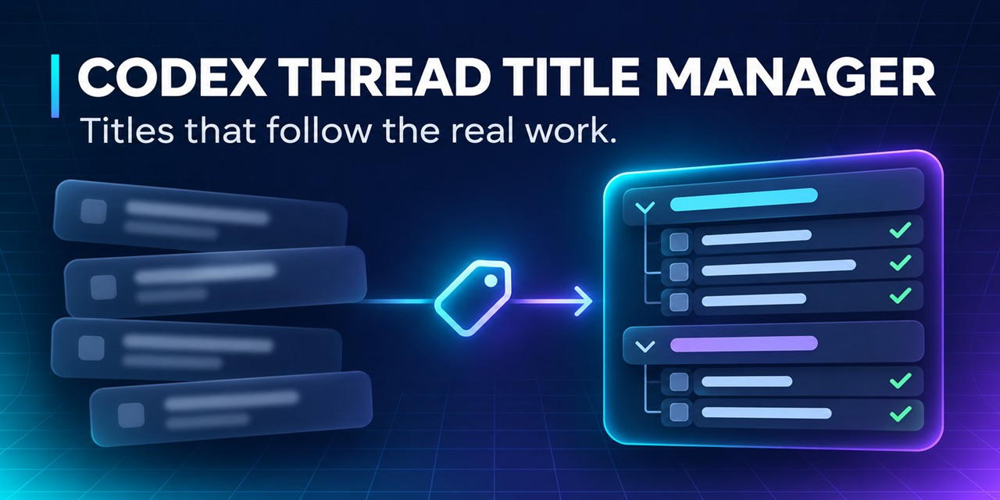
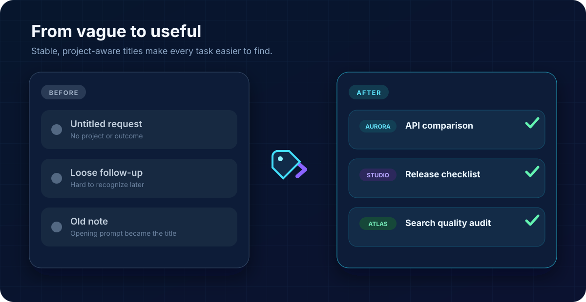
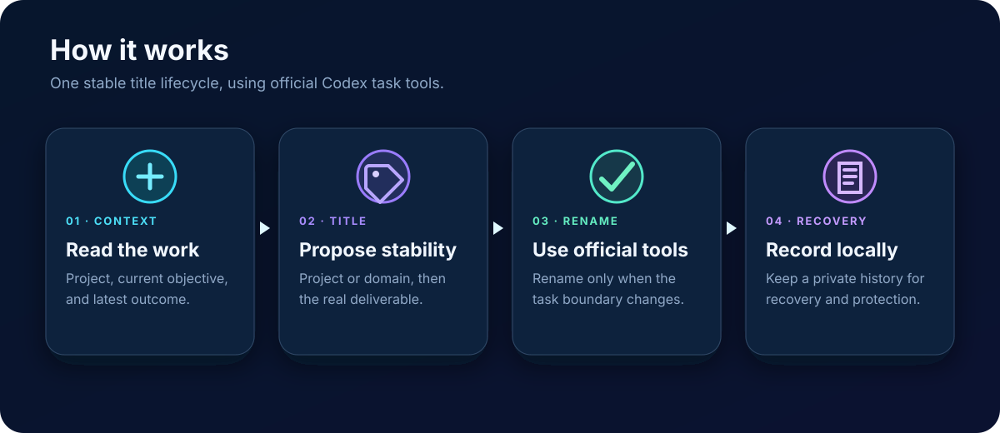
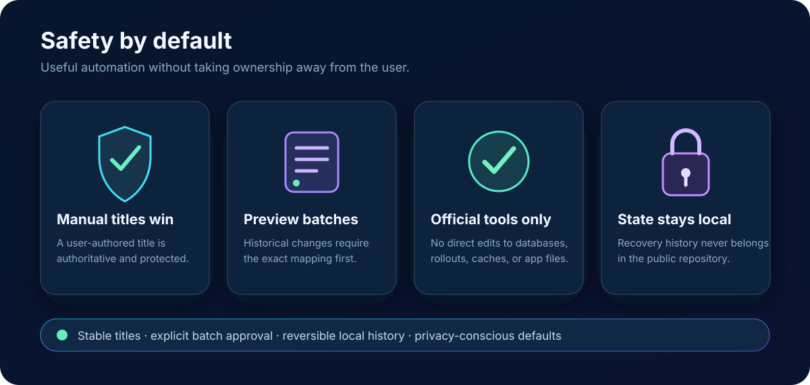

# Codex Thread Title Manager

[中文](README.md)

<p align="center">
  
</p>

Keep Codex sidebar titles aligned with the **real project and current work**, instead of leaving them tied to the first prompt, a raw URL, or an unspecified opening request.

## What it does

- Uses the default shape `Project or domain｜Concrete task or deliverable`.
- Renames only when the project, primary object, deliverable, or task boundary changes materially.
- Leaves ordinary follow-ups, clarifications, and revisions under the same stable title.
- Preserves user-authored or manually changed titles.
- Previews historical mappings before any batch rename.
- Uses official Codex task tools rather than editing databases, rollouts, caches, or application files.
- Keeps local rename history for recovery and manual-title detection.

## What it is not

This is not a background daemon or scheduler. Automatic upkeep is performed by the Agent inside each Codex task, following the global `AGENTS.md` policy and calling the official title tool. It does not run on clients that lack `list_threads`, `read_thread`, or `set_thread_title`.

## At a glance

Turn hard-to-recognize opening titles into stable, searchable `Project｜Real task` labels:

<p align="center">
  
</p>

Upkeep runs only when the objective or task boundary changes materially:

<p align="center">
  
</p>

Manual titles stay authoritative, batch changes are preview-first, and Codex internals are never edited directly:

<p align="center">
  
</p>

## Requirements

- Codex Desktop / ChatGPT Desktop with official task reading and title tools.
- Python 3.10 or newer.

## Install

```powershell
git clone https://github.com/zichen-aigc/codex-thread-title-manager.git
$source = Resolve-Path '.\codex-thread-title-manager\codex-thread-title-manager'
$target = Join-Path $env:USERPROFILE '.codex\skills\codex-thread-title-manager'
if (Test-Path -LiteralPath $target) {
    $backup = "$target.backup-$(Get-Date -Format yyyyMMdd-HHmmss)"
    Move-Item -LiteralPath $target -Destination $backup
}
Copy-Item -LiteralPath $source -Destination $target -Recurse
```

Then merge the marked block from [`templates/AGENTS.title-policy.en.md`](templates/AGENTS.title-policy.en.md) into your user-level `~/.codex/AGENTS.md`. Replace an existing block with the same markers instead of appending a duplicate. Refresh Codex or start a new chat.

## Use

```text
Use $codex-thread-title-manager to maintain this chat title from the real project and current task.
```

```text
Use $codex-thread-title-manager to preview suggested titles for my 20 most recent Codex tasks. Do not rename them yet.
```

Historical and batch changes always require the complete `old title → new title` mapping and explicit approval of that exact mapping.

## Local state and privacy

The default state file is `%LOCALAPPDATA%\CodexThreadTitleManager\state.json`. It stores task IDs, project labels, old titles, new titles, reasons, and timestamps for recovery. It does not store prompts or transcripts, but **titles can still contain sensitive information**. Protect the local account and never commit this state file.

If a crashed process leaves the state locked, first confirm that no title-manager process is still running, then delete `%LOCALAPPDATA%\CodexThreadTitleManager\state.json.lock`. Never remove the lock while another title-manager process is active.

## Test

```powershell
python -m unittest discover -s tests -v
python -m py_compile codex-thread-title-manager/scripts/title_state.py tests/test_title_state.py
```

## Background and acknowledgements

This is an independent implementation, not a fork, and it does not copy source code from the projects below. The design was informed by their public discussion of title lifecycle behavior:

- [openai/codex #24060](https://github.com/openai/codex/issues/24060)
- [Deep-Octopus/codex-latest-task-title](https://github.com/Deep-Octopus/codex-latest-task-title)
- [znbsf/codex-task-title-organizer](https://github.com/znbsf/codex-task-title-organizer)
- [ChenTingToDo/codex-task-title-manager](https://github.com/ChenTingToDo/codex-task-title-manager)

Licensed under the [MIT License](LICENSE).

