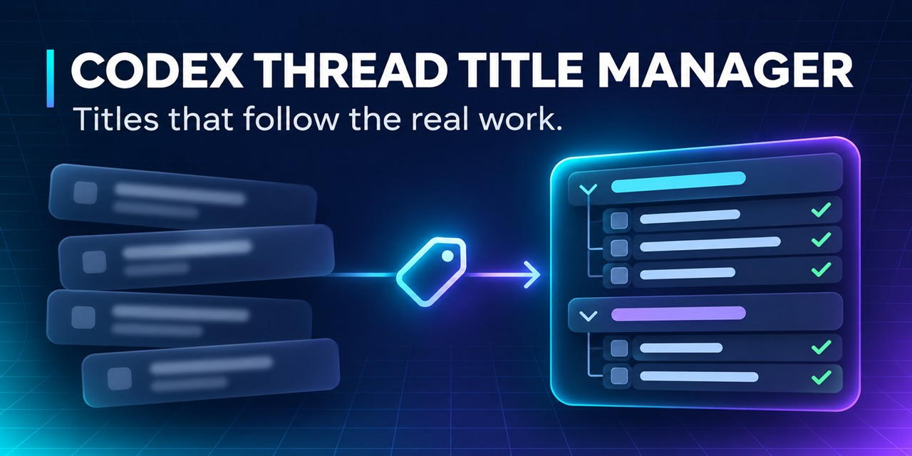
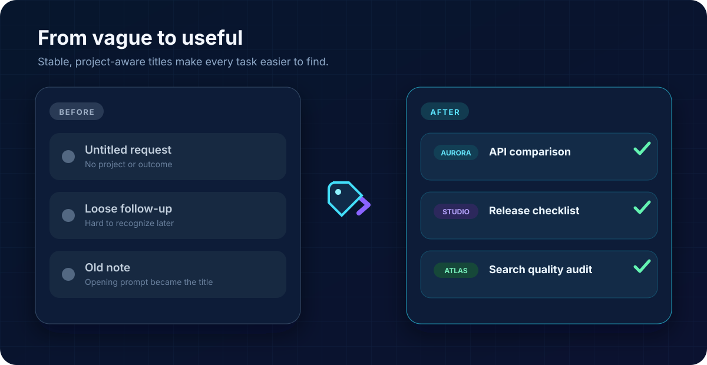
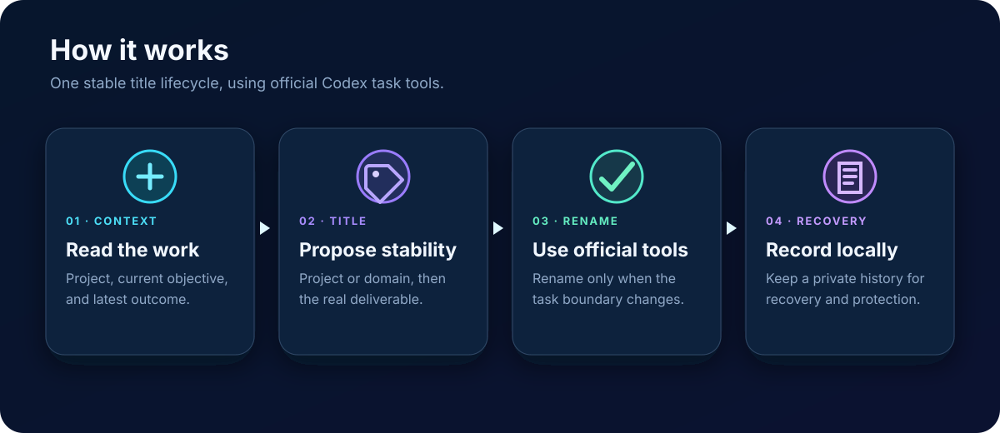
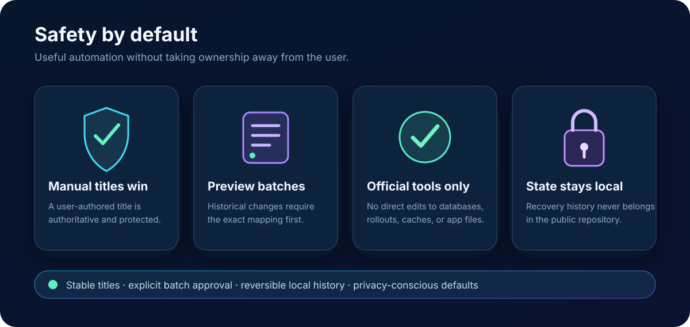

# Codex Thread Title Manager

[English](README.en.md)

<p align="center">
  
</p>

让 Codex 侧栏标题跟随**真实项目和当前任务**，而不是长期停留在第一条消息、原始网址或“未说明对象的开场请求”。

## 它解决什么

- 当前任务目标明确后，生成 `项目或领域｜真实主任务或交付物` 格式的标题。
- 只有项目、主要对象、交付物或任务边界实质改变时才更新。
- 普通追问、补充和返修不会反复改名。
- 用户手动设置的标题优先，不自动覆盖。
- 历史任务先生成完整预览，确认确切映射后才批量改名。
- 改名通过 Codex 官方任务工具完成，不直接修改数据库、rollout、缓存或应用文件。
- 本地保存改名前后记录，便于恢复和识别手动改名。

## 它不是什么

这不是后台守护进程，也不是定时任务。自动维护由每个 Codex 任务内的 Agent 按全局 `AGENTS.md` 规则调用官方标题工具完成。若客户端没有 `list_threads`、`read_thread` 或 `set_thread_title` 能力，标题管理不会运行。

## 一眼看懂

从难以辨认的开场标题，整理成稳定、可检索的“项目｜真实任务”：

<p align="center">
  
</p>

维护过程只在目标或任务边界真正变化时发生：

<p align="center">
  
</p>

用户手动标题优先，批量改名前必须预览，而且不直接修改 Codex 内部存储：

<p align="center">
  
</p>

## 仓库结构

```text
codex-thread-title-manager/
├── SKILL.md
├── agents/openai.yaml
└── scripts/title_state.py
templates/
├── AGENTS.title-policy.zh-CN.md
└── AGENTS.title-policy.en.md
tests/
└── test_title_state.py
```

## 要求

- 支持 Codex 官方任务读取和改名工具的 Codex Desktop / ChatGPT Desktop。
- Python 3.10 或更高版本。

## 安装

1. 克隆本仓库：

   ```powershell
   git clone https://github.com/zichen-aigc/codex-thread-title-manager.git
   ```

2. 把 Skill 目录复制到 Codex 的用户级 Skills：

   ```powershell
   $source = Resolve-Path '.\codex-thread-title-manager\codex-thread-title-manager'
   $target = Join-Path $env:USERPROFILE '.codex\skills\codex-thread-title-manager'
   if (Test-Path -LiteralPath $target) {
       $backup = "$target.backup-$(Get-Date -Format yyyyMMdd-HHmmss)"
       Move-Item -LiteralPath $target -Destination $backup
   }
   Copy-Item -LiteralPath $source -Destination $target -Recurse
   ```

3. 将 [`templates/AGENTS.title-policy.zh-CN.md`](templates/AGENTS.title-policy.zh-CN.md) 中的受标记规则块加入用户级 `~/.codex/AGENTS.md`。如果已有同名起止标记，请替换原块，不要重复追加。

4. 刷新 Codex，或在下一个新聊天中使用。

## 使用

整理当前任务：

```text
使用 $codex-thread-title-manager，根据当前项目和真实任务维护这个聊天的标题。
```

预览历史任务：

```text
使用 $codex-thread-title-manager，预览最近20个 Codex 任务的建议标题；不要直接改名。
```

历史或批量改名必须先展示完整的“原标题 → 新标题”映射，并取得用户对确切映射的确认。

## 本地状态与隐私

默认状态文件：

```text
%LOCALAPPDATA%\CodexThreadTitleManager\state.json
```

状态文件保存任务 ID、项目标签、原标题、新标题、原因和时间戳，以支持恢复和手动标题保护。它不保存提示词或聊天正文，但**标题本身可能包含敏感信息**。请保护本机账户，不要把该状态文件提交到 Git 仓库。

若进程异常退出后提示状态被锁定，请先确认没有标题管理进程仍在运行，再删除 `%LOCALAPPDATA%\CodexThreadTitleManager\state.json.lock`。不要在另一个标题管理进程运行时删除锁文件。

## 测试

```powershell
python -m unittest discover -s tests -v
python -m py_compile codex-thread-title-manager/scripts/title_state.py tests/test_title_state.py
```

## 背景与致谢

本项目是独立实现，不是下列项目的 fork，也没有复制其源码。设计时参考了这些公开问题和方案对标题生命周期的讨论：

- [openai/codex #24060](https://github.com/openai/codex/issues/24060)
- [Deep-Octopus/codex-latest-task-title](https://github.com/Deep-Octopus/codex-latest-task-title)
- [znbsf/codex-task-title-organizer](https://github.com/znbsf/codex-task-title-organizer)
- [ChenTingToDo/codex-task-title-manager](https://github.com/ChenTingToDo/codex-task-title-manager)

## 许可证

[MIT](LICENSE)

